<!-- The pictures are drawn in Edge's style by build/build.py; rebuild them after changing their text. -->

  <picture>
    <source media="(prefers-color-scheme: dark)" srcset="assets/hero-dark.svg">
    
  </picture>

  <a href="https://atomi7e.github.io/edge-app/">
    <picture>
      <source media="(prefers-color-scheme: dark)" srcset="assets/edge-dark.svg">
      
    </picture>
  </a>

  <a href="https://github.com/atomi7e?tab=repositories">
    <picture>
      <source media="(prefers-color-scheme: dark)" srcset="assets/projects-dark.svg">
      
    </picture>
  </a>

  <picture>
    <source media="(prefers-color-scheme: dark)" srcset="assets/about-dark.svg">
    
  </picture>

